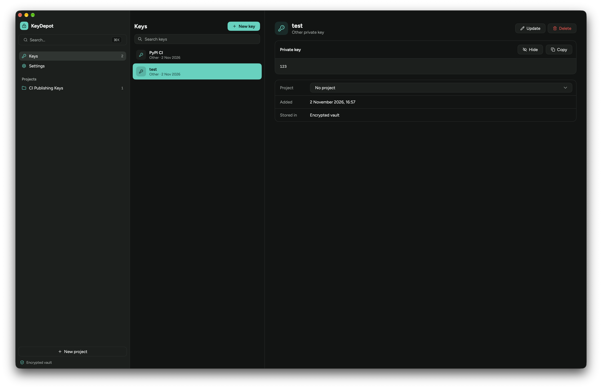

# KeyDepot

A desktop app that keeps your private keys encrypted, on your own computer. Store SSH, PGP and other private keys in one vault, group them by project, and copy one when you need it.



> **Beta.** KeyDepot hasn't had an independent security review. Keep another backup of any key you can't afford to lose.

## Features

- **Encrypted vault:** every key is sealed with AES-256-GCM in a single local file.
- **Your choice of protection:** a KeyDepot password with a recovery code, no extra prompt, or on macOS, Touch ID or your Mac password.
- **Projects and search:** group keys, search them, and do everything from the command palette.
- **Public keys and notes:** see an SSH key's public key and fingerprint, and keep encrypted notes beside each key.
- **Careful with secrets:** the clipboard clears after 60 seconds, and KeyDepot locks when your computer sleeps, locks or sits idle, or when you close the window.
- **Encrypted export and import:** move keys between computers in a password-protected file.
- **.env import and copy:** turn `.env` files into keys, and copy a project back as `.env`.
- **Signed updates:** the app checks for new versions and verifies them before installing.

KeyDepot has no account and no cloud sync. Its only network traffic is checking for and downloading updates.

## Install

KeyDepot has builds for macOS, Windows and Linux. **Windows and Linux builds are untested so far**, so try them with keys you have another copy of.

> **KeyDepot isn't signed by Apple or Microsoft yet.** Your system can't confirm who made the app, so macOS and Windows warn you or block it, and you have to allow it yourself. Only do this with a copy downloaded from this repository's [Releases](https://github.com/tbdsux/keydepot/releases) page.

You can compare a download with the release's `SHA256SUMS` file. This catches a broken download, but `SHA256SUMS` isn't signed, so it doesn't prove who made the file.

### macOS

Needs macOS 12 or later.

1. Download the disk image from [Releases](https://github.com/tbdsux/keydepot/releases): `keydepot-<version>-arm64.dmg` for Apple Silicon (M1 or later), or `keydepot-<version>-amd64.dmg` for Intel. To check which you have, open the Apple menu and choose **About This Mac**.
2. Open the disk image and drag KeyDepot to Applications.
3. Open KeyDepot from Applications. macOS blocks it, so close the message.
4. Go to **System Settings → Privacy & Security** and scroll down to **Security**.
5. Choose **Open Anyway** next to the message about KeyDepot, then confirm with your Mac password or Touch ID.

If there's no **Open Anyway** button, or macOS says the app is damaged, remove the download's quarantine flag instead, then open the app again:

```bash
xattr -dr com.apple.quarantine /Applications/KeyDepot.app
```

You only need to do this for the first launch.

### Windows

1. Download `keydepot-setup-<version>-amd64.exe` from [Releases](https://github.com/tbdsux/keydepot/releases), or the `arm64` version for Windows on Arm.
2. Run it. If SmartScreen says it protected your PC, choose **More info**, then **Run anyway**.
3. Follow the installer. It installs for your user only and doesn't need administrator rights.

### Linux

KeyDepot needs GTK 3. The tray icon also needs `libayatana-appindicator3`, and without it, closing the window quits the app. The Touch ID-style system prompt isn't available, and **No extra prompt** needs a Secret Service such as GNOME Keyring or KWallet. A KeyDepot password works without one.

**To get in-app updates**, download `keydepot-<version>-linux-amd64.tar.gz` (or `arm64`) and `install.sh` from [Releases](https://github.com/tbdsux/keydepot/releases) into one folder, then run this from that folder. It installs for your user in `~/.local`, without root:

```bash
sh install.sh keydepot-<version>-linux-amd64.tar.gz
```

**On Debian or Ubuntu**, you can install the package instead. It doesn't update itself, so install each new version the same way:

```bash
sudo apt install ./keydepot_<version>_amd64.deb
```

### Updating

KeyDepot offers new versions itself and checks their signature before installing them. See [Updates](docs/usage.md#updates).

On macOS, because the app isn't signed by Apple, macOS may ask again for access to KeyDepot's Keychain item after an update, unless you use a KeyDepot password. Choose **Always Allow** if you trust the update. Those modes have no recovery code, so keep a recent [export](docs/usage.md#backups-and-moving-computers) in case the vault doesn't open.

### Uninstalling

Export any keys you want to keep, then quit KeyDepot from its menu.

- **macOS:** move the app to the Trash.
- **Windows:** remove it from **Settings → Apps**.
- **Linux:** run `sh install.sh --uninstall`, or `sudo apt remove keydepot` if you installed the package.

Uninstalling keeps your vault, until you delete its folder. See [where your files are](docs/usage.md#where-your-files-are). **Deleting it can't be undone, and it removes your keys.**

In the modes without a KeyDepot password, the vault's key also stays in your system's secret store, under `dev.tbdsux.keydepot`.

## Build from source

You need Go 1.27.3 or later. Run MyGo from the project root:

```bash
go tool mygo dev
```

```bash
go tool mygo build
```

To run the checks:

```bash
CGO_ENABLED=0 go test ./...
```

```bash
go tool mygo vet .
```

## Documentation

- [Using KeyDepot](docs/usage.md): protection modes, managing keys, shortcuts, backups
- [Security](docs/security.md): how keys are encrypted, what that protects against, and what it doesn't
- [Architecture](docs/architecture.md): how the code is organized and how the app runs

## Reporting a security problem

Please don't open a public issue for a vulnerability. Use GitHub's [private vulnerability reporting](https://github.com/tbdsux/keydepot/security/advisories/new) instead.

## Credits

Built with [MyGo](https://github.com/egoist/mygo). Uses the [Figtree](https://github.com/erikdkennedy/figtree) font (SIL Open Font License) and [Lucide](https://lucide.dev) icons (ISC License).

## License

[MIT](LICENSE)
